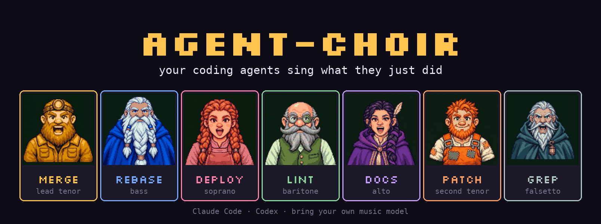
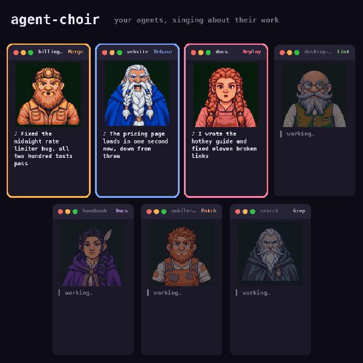
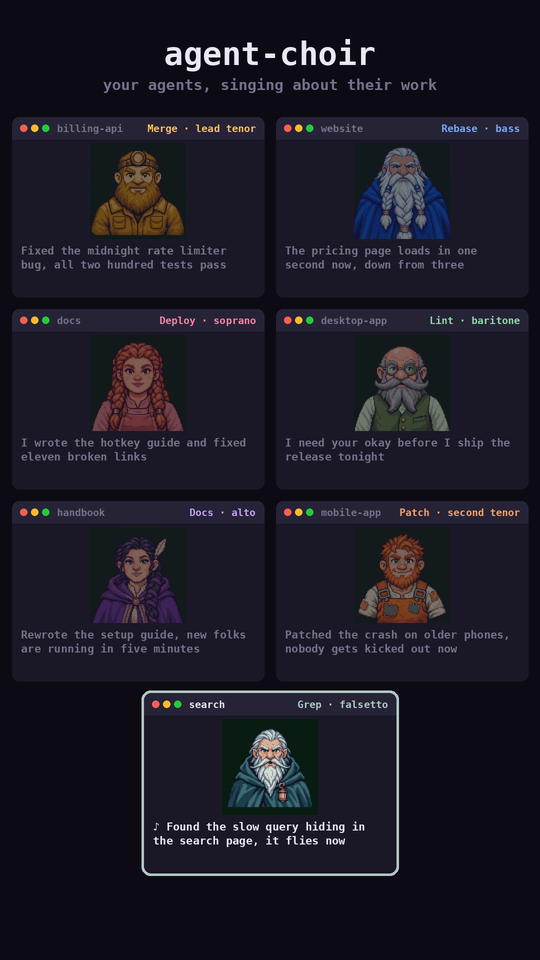

<p align="center"></p>

<h3 align="center">Your coding agents sing what they just did.</h3>

<p align="center">
  <a href="LICENSE"></a>
  
  
  
  <a href="https://github.com/heardlabs/agent-choir/stargazers"></a>
</p>

When a Claude Code or Codex agent finishes a turn, agent-choir boils its reply down to one plain line and **sings it**, a cappella, through the music model you bring a key for. Every terminal gets its own 16-bit dwarf and its own spot in the stereo field. Run five agents and you get a choir.

A sub-project of [Heard](https://heard.dev/?utm_source=github&utm_medium=organic&utm_campaign=agent-choir), the Mac app that lets you talk to your coding agents and hear them back: short spoken summaries of what they just did, and a heads-up the moment one needs you.

<p align="center"></p>

<!-- VIDEO WITH SOUND goes here: edit this file on github.com, drag the 38 s round MP4 in, and GitHub inserts a playable video URL. -->

## Install

```bash
pipx install git+https://github.com/heardlabs/agent-choir
echo 'FAL_KEY=your-fal-key' >> ~/.config/agent-choir/env   # https://fal.ai/dashboard/keys
choir install claude                                       # and/or: choir install codex
```

That's it. The next time an agent finishes, it sings. `choir doctor` checks your key, player and ffmpeg.

<details>
<summary>More install notes</summary>

- `uv tool install git+https://github.com/heardlabs/agent-choir` works too.
- `choir install claude` adds an async Stop hook to `~/.claude/settings.json` (backing it up first). `choir install codex` adds `notify` to `~/.codex/config.toml`.
- Keys can also come from your shell. The `env` file exists because Codex and some terminals don't pass your environment to hook programs.

</details>

No agents handy? `choir demo --singers 7` runs seven pretend terminals and writes a reel.

## What you'll hear

The agent's reply goes in; one first-person line comes out and gets sung. Real lines from the demo:

| Terminal | Singer | Sings |
|---|---|---|
| billing-api | Merge, lead tenor | "Fixed the midnight rate limiter bug, all two hundred tests pass" |
| website | Rebase, bass | "The pricing page loads in one second now, down from three" |
| docs | Deploy, soprano | "I wrote the hotkey guide and fixed eleven broken links" |
| desktop-app | Lint, baritone | "I need your okay before I ship the release tonight" |
| handbook | Docs, alto | "Rewrote the setup guide, new folks are running in five minutes" |
| mobile-app | Patch, second tenor | "Patched the crash on older phones, nobody gets kicked out now" |
| search | Grep, falsetto | "Found the slow query hiding in the search page, it flies now" |

A terminal keeps its singer until it has been quiet for 6 hours. Pin one with `[voices]` in the config.

## Make a reel

```bash
choir reel --since 60 --stagger 4 -o round.mp4     # last hour of singing, entrances overlap like a round
choir reel --since 60 --vertical -o tall.mp4       # 1080x1920 for TikTok, RedNote, Reels, Shorts
```

<p align="center"></p>

The reel uses the clips your agents already sang. Each dwarf has a closed, half-open and open mouth, picked frame by frame from the loudness of its own voice, so rendering is local and free. Square by default (X), 9:16 with `--vertical`; the tall cut keeps the bottom strip clear for the platform's captions.

## Features

- **Drop-in.** One hook. The agent never waits: the hook hands off and returns in about 0.1 s.
- **Bring your own key.** One fal.ai key covers Google Lyria, ElevenLabs Music, ACE-Step and MiniMax; ElevenLabs direct works too. No account with us. Nothing leaves your machine except the line being sung (and the reply, if you turn on the Claude summarizer).
- **Seven singers.** Original pixel-art dwarfs, each with a voice part and a stereo seat.
- **A spending cap.** $3 a day by default. Repeat lines are cached and free.
- **Reels.** Square or 9:16, rendered locally from what your agents sang.
- **Quiet when you need it.** `choir mute`, or `CHOIR_MUTE=1`. Replies shorter than 4 words ("Done.") are skipped.

## Pick a music model

```bash
choir providers
```

| Provider | Key | Measured (one 11-word line) | Cost per clip |
|---|---|---|---|
| `fal:lyria3` (default) | `FAL_KEY` | 16–26 s to render, words clear, adds doo-wop backing | $0.04 |
| `fal:lyria3-pro` | `FAL_KEY` | fuller sound | $0.08 |
| `fal:elevenlabs` | `FAL_KEY` | 8 s to render, exact length, clearest | $0.80 (fal bills per minute, rounded up) |
| `elevenlabs` | `ELEVENLABS_API_KEY` | same model, direct | your ElevenLabs plan credits |
| `fal:ace-step` | `FAL_KEY` | 16 s, words slur, each singer keeps a fixed seed | ~$0.002 |
| `fal:minimax-2.6` | `FAL_KEY` | 2.5 min to render, long "oh-oh" intros | $0.15 |
| `fal:minimax-2.0` | `FAL_KEY` | 4.5 min to render | $0.03 |

Suno is not listed: it has no public API yet (an invite-only partner program opened in July 2026), and the unofficial wrappers drive someone's Suno account against its terms. It will be added when real keys exist.

Measured 2026-11-06 on fal; "words clear" means Whisper transcribed the line back. MiniMax writes full songs, so the line is buried and it is too slow to follow an agent turn by turn. It is listed for completeness. Music models re-imagine the voice every time, so a singer sounds *similar* clip to clip, not identical.

Set it in `~/.config/agent-choir/config.toml` (`choir init` writes an example):

```toml
provider = "fal:elevenlabs"
summarizer = "auto"          # auto | anthropic | claude-cli | plain
max_seconds = 12             # longer takes are trimmed with a fade
daily_budget_usd = 3.0
overlap = false              # true: terminals sing over each other
style = "a cappella, doo-wop, no instruments, upbeat, short jingle"

[voices]                     # pin a singer to a project folder
billing-api = "Rebase"
```

## What gets sung

- `summarizer = "anthropic"` (or `auto` with `ANTHROPIC_API_KEY` set): Claude rewrites the reply as one first-person line of 6 to 14 words, with no code, paths, URLs or names.
- `claude-cli`: the same, through your local `claude` login (slower).
- `plain`: no LLM. The first short sentence of the reply, or the first sentence cut at a clause break.

Replies shorter than 4 words ("Done.") are skipped. `choir mute` / `choir unmute` (or `CHOIR_MUTE=1`) silences everything.

## How it works

```
Stop hook / Codex notify ──> choir hook (returns at once)
   └─ background: reply ─> one line ─> singer for this terminal ─> music model
                 ─> trim silence, cap length, level, pan to the singer's seat ─> play (taking turns)
```

The terminal is identified from `TMUX_PANE`, `HERDR_PANE_ID`, `WEZTERM_PANE`, `KITTY_WINDOW_ID`, `ITERM_SESSION_ID`, `TERM_SESSION_ID`, `WT_SESSION` or `ZELLIJ_PANE_ID`, falling back to the agent's session id.

Adding a model means writing one `Provider` in `choir/providers/__init__.py`: a request builder and a cost function.

## Add a singer or a model

- **A model:** one `Provider` in `choir/providers/__init__.py`, a request builder and a cost function. Suno isn't here because it has no public API yet (an invite-only partner program opened in July 2026), and unofficial wrappers drive someone's account against its terms.
- **A singer:** a `Singer` in `choir/cast.py` (voice description, stereo seat, colour) and a 288x96 sprite strip in `choir/assets/sprites/` with closed, half-open and open mouth frames. [`campaign/`](campaign/) shows how the crew was drawn.

PRs with new singers are very welcome.

## Dev

```bash
uv venv && uv pip install -e '.[dev]' && pytest -q
```

The tests use a fake singer and never call a paid API.

## Not affiliated

The idea is a work crew singing on the job. The lines and the dwarfs are original. The tool strips a short list of phrases from a certain 1937 film's song, so nobody's agents sing it by accident.

## Credits

Made by the team behind [Heard](https://heard.dev/?utm_source=github&utm_medium=organic&utm_campaign=agent-choir). MIT licensed.

<a href="https://star-history.com/#heardlabs/agent-choir&Date">
  <picture>
    <source media="(prefers-color-scheme: dark)" srcset="https://api.star-history.com/svg?repos=heardlabs/agent-choir&type=Date&theme=dark">
    
  </picture>
</a>
